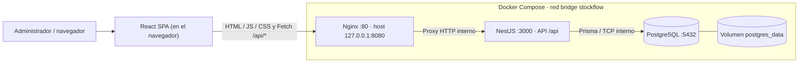
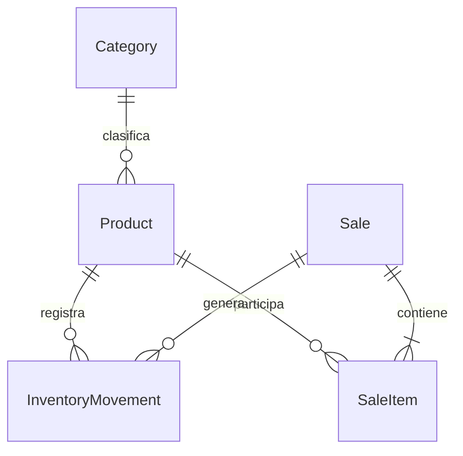

# StockFlow — Sistema Web de Gestión de Inventario y Ventas

StockFlow centraliza el catálogo, las existencias y las ventas de una pequeña empresa. Incluye una interfaz React en español, un API Gateway Nginx, un microservicio NestJS y PostgreSQL persistente. El único puerto HTTP publicado es **8080**, limitado a la computadora local.

| Datos académicos | |
|---|---|
| Universidad | Universidad Católica Boliviana |
| Asignatura | Tecnologías Web II |
| Evaluación | Segundo Parcial — 100 puntos |
| Docente | Ing. Miguel A. Pacheco |
| Estudiante | Kevin Tapia Ali |
| Tecnología backend asignada | NestJS con TypeScript |

**Estado de entrega:** implementación y documentación preparadas. No se levantaron contenedores ni servidores, ni se ejecutaron pruebas de integración o de navegador durante la generación. Consultar [VERIFICACION.md](docs/VERIFICACION.md) para las comprobaciones realmente realizadas. Las evidencias de ejecución y la publicación en GitHub requieren acciones manuales.

## 1. Problema, justificación y objetivos

El registro de ventas en cuadernos o planillas independientes dificulta conocer las existencias reales. Puede producir ventas sin stock, duplicación de productos y pérdida de historial. Para una pequeña empresa, una aplicación centralizada permite tomar decisiones de reposición y mantener trazabilidad sin introducir un ERP completo.

**Objetivo general:** desarrollar una plataforma web de inventario y ventas con responsabilidades separadas, datos persistentes y operaciones de negocio consistentes.

**Objetivos específicos:**

- Organizar productos mediante categorías y SKU únicos.
- Permitir altas, consultas, actualizaciones y eliminaciones compatibles con el historial.
- Registrar entradas y salidas sin permitir stock negativo.
- Confirmar ventas con varios productos en una transacción y calcular importes en el backend.
- Anular ventas restituyendo existencias una sola vez.
- Mostrar indicadores reales y productos que requieren reposición.
- Demostrar proxy inverso, CORS, logging, rate limiting y orquestación Docker.

### Funcionalidades incluidas

| Módulo | Funcionalidad |
|---|---|
| Dashboard | Productos, categorías, bajo stock, ventas, ingresos confirmados y movimientos recientes |
| Categorías | Crear, listar, consultar, editar y eliminar; nombre único y protección de relaciones |
| Productos | CRUD, búsqueda por nombre/SKU, filtro por categoría y paginación; estado activo/inactivo |
| Inventario | Entradas, salidas e historial paginado por producto; operaciones atómicas |
| Ventas | Registro con múltiples productos, listado, detalle histórico y anulación |
| Interfaz | Diseño responsive, modales, validaciones, carga, errores, notificaciones y página 404 |
| API | Validación de DTO, OpenAPI, errores sin trazas internas, salud de aplicación y BD |

No se incluyen autenticación, pagos, facturación tributaria ni integraciones bancarias. **Es una demostración académica local sin autenticación.** Para producción pública son necesarios autenticación, autorización, HTTPS, secretos administrados y una revisión de seguridad. CORS no reemplaza autenticación.

## 2. Arquitectura y flujo HTTP



1. El navegador solicita `http://localhost:8080`. Nginx sirve los archivos compilados por Vite.
2. React hace Fetch a una ruta relativa como `/api/products?page=1`.
3. Nginx aplica cabeceras, registra la solicitud, evalúa el límite y la reenvía a `backend:3000`, conservando `/api`.
4. NestJS valida el DTO. El controller delega al service, que aplica reglas y usa el repository.
5. El repository accede a PostgreSQL mediante Prisma. Operaciones compuestas se confirman o revierten juntas.
6. La respuesta vuelve por Nginx, con el mismo código de negocio y un `X-Request-ID` correlacionable.

React es un contenedor lógico C4, pero no un servidor Docker separado: la imagen del Gateway incorpora su compilación. Backend y BD **no tienen `ports` publicados**. Los servicios se encuentran por sus nombres DNS `backend` y `db`, no por `localhost`.

Diagramas formales y versiones insertables: [C4 Nivel 1](docs/c4/contexto.svg), [C4 Nivel 2](docs/c4/contenedores.svg), [fuentes Mermaid](docs/c4/README.md).

## 3. Tecnologías y decisiones

| Herramienta | Versión de referencia | Función y justificación |
|---|---|---|
| React / TypeScript | 19.1.1 / 5.9.2 | Componentes, formularios y tipado estricto |
| Vite | 7.1.7 | Compilación del frontend para servir archivos estáticos |
| Tailwind CSS | 4.1.13 | Integración Vite y base visual; estilos propios para el panel |
| React Router | 7.9.1 | Navegación SPA y rutas de detalle |
| Fetch | API del navegador | Cliente centralizado, errores y cancelación de consultas |
| NestJS | 11.1.6 | Módulos, controllers, services e inyección de dependencias |
| Prisma | **6.16.2** | ORM, cliente tipado y migraciones; se fija esta versión deliberadamente |
| class-validator / transformer | 0.14.2 / 0.5.1 | Validación y transformación explícita de DTO |
| Swagger para NestJS | 11.2.0 | Documentación interactiva y exportación OpenAPI |
| PostgreSQL | 17 | Claves foráneas, restricciones, decimales y transacciones |
| Nginx | 1.28 | Proxy inverso, frontend estático y funciones transversales |
| Node.js en imágenes | 22 | Runtime compatible con la configuración fijada |
| Docker Compose v2 | Comando `docker compose` | Arranque, salud, red y volumen |

Los manifiestos fijan versiones directas. No se generaron lockfiles durante esta entrega, por lo que las dependencias transitivas se resolverán al construir las imágenes. Antes de congelar una entrega reproducible, generar y versionar los dos `package-lock.json` y cambiar `npm install` por `npm ci` en las etapas que consumen esos manifiestos. No actualizar Prisma a otra versión mayor sin adaptar el esquema, cliente y comandos.

## 4. Estructura del repositorio

```text
.
├── backend/
│   ├── src/
│   │   ├── common/          # Validación, errores, dinero y paginación
│   │   ├── database/        # PrismaService e inyección global
│   │   └── modules/         # categories, products, inventory, sales, dashboard
│   ├── prisma/
│   │   ├── schema.prisma
│   │   ├── migrations/     # SQL versionado, sin reset automático
│   │   └── seed.cjs
│   ├── Dockerfile
│   └── entrypoint.sh
├── frontend/
│   ├── src/                # components, layouts, pages, hooks, services, types, utils
│   └── public/
├── gateway/
│   ├── nginx.conf
│   ├── conf.d/default.conf.template
│   ├── snippets/
│   └── Dockerfile          # Compila React y lo copia a Nginx
├── docs/
│   ├── api/                # Contrato, ejemplos JSON y colección Postman
│   ├── c4/                 # Mermaid y SVG
│   ├── evidencias/         # Guía de evidencias reales
│   ├── INFORME_TECNICO.md
│   ├── INFORME_TECNICO.html
│   ├── GUIA_DEFENSA.md
│   └── VERIFICACION.md
├── scripts/                # Demostración manual, rate limiting y documentación
├── .env.example
├── .gitignore
└── docker-compose.yml
```

## 5. Requisitos previos

- Windows 10/11 con virtualización habilitada y Docker Desktop configurado para **contenedores Linux**, normalmente mediante WSL 2.
- Docker Desktop iniciado; Docker Engine y Compose v2 disponibles.
- Git para Windows.
- Navegador moderno.
- Orientativamente 8 GB de RAM total, 4 GB disponibles para Docker y unos 5 GB libres de disco. La primera construcción necesita internet.
- No se requiere instalar Node.js, PostgreSQL ni Nginx en Windows para ejecutar con Docker. Node 22 es opcional para los scripts `.mjs`.

Comprobar en PowerShell:

```powershell
git --version
docker --version
docker compose version
docker info
```

`docker info` debe comunicarse con Docker Desktop. No continuar con la construcción si el motor no está disponible.

## 6. Instalación paso a paso en Windows

### 6.1 Abrir PowerShell y obtener el proyecto

Después de publicar el repositorio, reemplazar `TU_USUARIO` por el usuario real de GitHub:

```powershell
git clone https://github.com/TU_USUARIO/stockflow.git
Set-Location .\stockflow
```

Si ya estás usando la carpeta de esta entrega, no clones otra copia:

```powershell
Set-Location 'D:\UNIVERSIDAD CATOLICA\1.- SEGUNDO SEMESTRE 2026\TECWEB II\SEGUNDO PARCIAL\EXAMEN PRACTICO TEC_WEB_II'
```

### 6.2 Crear la configuración local

```powershell
Copy-Item .env.example .env
notepad .env
```

No sobrescribir `.env` si ya contiene configuración propia. Los valores de ejemplo funcionan para uso local. Mantener usuario, contraseña y nombre de BD con letras, números y guiones bajos en esta plantilla: Compose construye una URL de conexión y los caracteres reservados requerirían codificación URL.

### 6.3 Construir y levantar

```powershell
docker compose up --build -d
docker compose ps
docker compose logs --tail=80 backend
```

La primera ejecución descarga imágenes, instala dependencias dentro de ellas, compila ambos proyectos, inicializa PostgreSQL, aplica migraciones y ejecuta el seed. Puede tardar varios minutos. Compose espera que la BD esté saludable antes del backend y que el backend esté saludable antes del Gateway.

El comando principal también tiene valores locales por defecto si no existe `.env`; se recomienda crearlo para hacer explícita la configuración.

### 6.4 Verificar y abrir

```powershell
curl.exe -i http://localhost:8080/gateway-health
curl.exe -i http://localhost:8080/api/health
curl.exe http://localhost:8080/api/products
Start-Process 'http://localhost:8080'
Start-Process 'http://localhost:8080/api/docs'
```

- **Frontend:** <http://localhost:8080>
- **Swagger:** <http://localhost:8080/api/docs>
- **OpenAPI JSON:** <http://localhost:8080/api/docs-json>
- **Salud del backend y BD:** <http://localhost:8080/api/health>

Tras el seed inicial habrá tres categorías y seis productos con movimientos de apertura. No se crean ventas ficticias: el usuario las registra. Repetir el seed no duplica SKU existentes ni restablece stock.

## 7. Variables de entorno

| Variable | Ejemplo | Finalidad y recomendaciones |
|---|---|---|
| `POSTGRES_USER` | `stockflow` | Usuario inicial de PostgreSQL; utilizado para construir DATABASE_URL |
| `POSTGRES_PASSWORD` | `stockflow_local_2026` | Contraseña **de demostración**, no adecuada para producción |
| `POSTGRES_DB` | `stockflow` | Base inicial |
| `GATEWAY_PORT` | `8080` | Único puerto del host; publicado sobre 127.0.0.1 |
| `CORS_ORIGIN` | `http://localhost:8080` | Origen exacto autorizado, sin barra final; cambiar junto al puerto |
| `SEED_ON_START` | `true` | Ejecutar seed idempotente después de migrar; usar `false` si no se desean ejemplos |
| `DATABASE_URL` | `postgresql://stockflow:...@db:5432/stockflow?schema=public` | Construida por Compose y suministrada solo al backend |
| `NODE_ENV` | `production` | Fijada en Compose para el backend |

Para otro puerto, por ejemplo 8081, cambiar `GATEWAY_PORT=8081` y `CORS_ORIGIN=http://localhost:8081`. Reiniciar con `docker compose up -d`. No usar comodines ni expresiones regulares en `CORS_ORIGIN`.

PostgreSQL utiliza sus variables de inicialización **solo al crear un volumen vacío**. Cambiar `.env` no cambia automáticamente usuarios/contraseñas de una BD existente. Actualizar las credenciales mediante SQL y después la configuración, o usar un volumen nuevo únicamente si se puede prescindir de los datos.

`.env` está excluido de Git. No pegarlo en evidencias ni publicar la salida de comandos que revelen configuración sensible.

## 8. Modelo de datos, migraciones y consistencia



- **Category:** nombre, clave normalizada única, descripción y fechas.
- **Product:** SKU único, nombre, descripción, precio, stock, mínimo, estado, categoría y fechas.
- **InventoryMovement:** producto, tipo, cantidad, motivo, fecha y venta opcional.
- **Sale:** cliente, total, estado, fecha, motivo y fecha de anulación.
- **SaleItem:** producto, cantidad y copia histórica del nombre, SKU, precio y subtotal.

Las FK usan `RESTRICT` para impedir pérdida accidental de referencias. Hay índices en categorías, SKU, fechas, estado y productos relacionados. Los `CHECK` SQL impiden stock o importes negativos, cantidades no positivas y estados de anulación contradictorios.

Dinero se guarda en `NUMERIC(12,2)` para precio y `NUMERIC(14,2)` para total/subtotal. Prisma usa `Decimal`; el interceptor serializa a cadenas con dos decimales. El frontend calcula estimaciones con centavos `BigInt`, pero **el servidor vuelve a calcular todo con precios de la BD**. La conversión a Number se utiliza solamente para formatear la presentación monetaria.

### Transacciones y concurrencia

`PrismaService.atomic()` ejecuta operaciones a nivel `Serializable`, con hasta tres intentos ante conflicto Prisma `P2034`. Un conflicto persistente devuelve 409. Los descuentos usan actualización condicionada a stock suficiente; no se depende únicamente de una consulta anterior.

La venta registra detalles, descuenta stock y crea movimientos dentro de la misma transacción. Si falla un producto, se revierte la operación completa. Los productos se procesan en orden estable para reducir bloqueos cruzados. La anulación cambia de `CONFIRMED` a `CANCELLED` mediante una actualización condicional y restituye stock dentro de la misma transacción. Si se repite, devuelve 409.

La creación de ventas no incluye claves de idempotencia para reintentos de red. La UI bloquea envíos duplicados mientras procesa. Si se pierde la respuesta tras confirmar, consultar el listado antes de volver a registrar.

### Política de eliminación e historial

- Categoría con productos: 409, incluso si los productos están inactivos.
- Producto sin stock ni historial: eliminación física 204.
- Producto con movimientos o ventas: 409. Usar `PATCH {"active":false}` para retirarlo de la operación.
- Producto inactivo: no admite ventas ni movimientos manuales. Una anulación histórica sí puede restituirle stock.
- Ventas y movimientos: permanentes; no hay DELETE. Corregir un movimiento con otro compensatorio.
- Stock no se acepta en PATCH de producto. Usar el módulo de movimientos.

### Migraciones, seed y consultas

```powershell
# Aplicar únicamente migraciones pendientes:
docker compose exec backend node /opt/migrations/node_modules/prisma/build/index.js migrate deploy

# Estado de migraciones:
docker compose exec backend node /opt/migrations/node_modules/prisma/build/index.js migrate status

# Repetir seed sin restablecer datos:
docker compose exec backend node prisma/seed.cjs

# Sesión SQL con las variables reales del contenedor:
docker compose exec db sh -c 'psql -U "$POSTGRES_USER" -d "$POSTGRES_DB"'
```

Dentro de `psql`:

```sql
SELECT "sku", "name", "price", "stock" FROM "Product";
SELECT "id", "customer", "total", "status" FROM "Sale";
SELECT "type", "quantity", "reason" FROM "InventoryMovement" ORDER BY "createdAt" DESC LIMIT 10;
```

Salir con `\q`. El arranque usa `migrate deploy`; no se ejecuta `db push`, `migrate reset`, truncado ni sincronización destructiva.

## 9. API REST

La tabla completa y ejemplos de respuestas están en [ENDPOINTS.md](docs/api/ENDPOINTS.md). Los DTO documentan sus cuerpos en Swagger.

| Método | Endpoint | Body esperado | Éxito |
|---|---|---|---|
| GET | `/api/categories` | — | 200: lista |
| GET | `/api/categories/:id` | — | 200: categoría |
| POST | `/api/categories` | `name`, `description?` | 201 |
| PATCH | `/api/categories/:id` | `name?`, `description?` | 200 |
| DELETE | `/api/categories/:id` | — | 204 |
| GET | `/api/products` | —; query search/categoryId/active/page/limit | 200: página |
| GET | `/api/products/:id` | — | 200: producto |
| POST | `/api/products` | `name`, `sku`, `price`, `categoryId`; opcionales description/stock/minStock/active | 201 |
| PATCH | `/api/products/:id` | Campos opcionales excepto stock | 200 |
| DELETE | `/api/products/:id` | — | 204 |
| GET | `/api/inventory/movements` | —; query productId/page/limit | 200: página |
| POST | `/api/inventory/movements` | `productId`, `type`, `quantity`, `reason` | 201 |
| GET | `/api/sales` | —; query page/limit | 200: página |
| GET | `/api/sales/:id` | — | 200: detalle |
| POST | `/api/sales` | `customer`, `items: [{productId,quantity}]` | 201 |
| PATCH | `/api/sales/:id/cancel` | `reason` | 200 |
| GET | `/api/dashboard/summary` | — | 200 |
| GET | `/api/health` | — | 200, o 503 |

Ejemplo de venta válida (usar un UUID real):

```json
{
  "customer": "Cliente de mostrador",
  "items": [
    {
      "productId": "22222222-2222-4222-8222-222222222222",
      "quantity": 2
    }
  ]
}
```

Los errores habituales son 400 (validación), 404 (inexistente), 409 (duplicado, relación o stock), 429 (límite), 500 (error interno) y 503 (indisponibilidad). Un error de NestJS contiene `statusCode`, `message`, `path`, `timestamp` y `requestId`. No se envían trazas al cliente.

## 10. Pruebas manuales con cURL, PowerShell y Postman

Usar **`curl.exe`** en Windows para evitar el alias `curl` de Windows PowerShell. Ejecutar los comandos desde la raíz del repositorio. Los JSON están en `docs/api/examples/`; editar los UUID ficticios antes de enviarlos.

```powershell
# 1. Crear una categoría; copiar su id de la respuesta.
curl.exe -i -X POST http://localhost:8080/api/categories -H "Content-Type: application/json" --data-binary "@docs/api/examples/category.json"

# 2. Editar categoryId y mantener stock=0 para demostrar DELETE.
notepad .\docs\api\examples\product.json
curl.exe -i -X POST http://localhost:8080/api/products -H "Content-Type: application/json" --data-binary "@docs/api/examples/product.json"

# 3. Asignar el UUID real obtenido.
$productId = Read-Host 'UUID del producto creado'
curl.exe -i "http://localhost:8080/api/products/$productId"

# 4. Actualizar.
curl.exe -i -X PATCH "http://localhost:8080/api/products/$productId" -H "Content-Type: application/json" --data-binary "@docs/api/examples/product-update.json"

# 5. Eliminar producto sin historial: 204 sin cuerpo.
curl.exe -i -X DELETE "http://localhost:8080/api/products/$productId"

# 6. Crear nuevamente el producto para probar inventario.
curl.exe -i -X POST http://localhost:8080/api/products -H "Content-Type: application/json" --data-binary "@docs/api/examples/product.json"
$productId = Read-Host 'UUID del nuevo producto'

# 7. Pegar ese UUID en movement.json.
notepad .\docs\api\examples\movement.json
curl.exe -i -X POST http://localhost:8080/api/inventory/movements -H "Content-Type: application/json" --data-binary "@docs/api/examples/movement.json"
curl.exe "http://localhost:8080/api/inventory/movements?productId=$productId"

# 8. Pegar el mismo UUID en sale.json.
notepad .\docs\api\examples\sale.json
curl.exe -i -X POST http://localhost:8080/api/sales -H "Content-Type: application/json" --data-binary "@docs/api/examples/sale.json"
$saleId = Read-Host 'UUID de la venta creada'
curl.exe "http://localhost:8080/api/sales/$saleId"

# 9. Anular y comprobar restitución.
curl.exe -i -X PATCH "http://localhost:8080/api/sales/$saleId/cancel" -H "Content-Type: application/json" --data-binary "@docs/api/examples/cancel.json"
curl.exe "http://localhost:8080/api/products/$productId"

# 10. Indicadores.
curl.exe http://localhost:8080/api/dashboard/summary
```

Después de una entrada de 10 y una venta de 2, el stock esperado es 8; tras anular, 10. Repetir la anulación debe devolver 409 y mantener 10. Si el precio es `"25.50"`, la venta de dos unidades debe totalizar `"51.00"`.

Para ejecutar un flujo manual completo con IDs propagados automáticamente:

```powershell
powershell.exe -NoProfile -ExecutionPolicy Bypass -File .\scripts\manual-demo.ps1
```

El permiso de ejecución se aplica solo a ese proceso, no cambia permanentemente la política de Windows. El script **crea datos reales**, comprueba el CRUD sin historial, registra inventario y una venta, verifica totales y anulación. No se ejecutó durante la generación.

### Postman

Importar `docs/api/StockFlow.postman_collection.json`. La variable `baseUrl` vale `http://localhost:8080`. Ejecutar las carpetas en orden: las solicitudes de creación guardan IDs en variables de colección. La carpeta CRUD elimina un producto sin historial; la carpeta Operaciones deja datos para evidenciar movimientos y ventas. Cada ejecución utiliza un sufijo nuevo.

También se puede importar `http://localhost:8080/api/docs-json` para obtener la definición OpenAPI. Capturar resultados reales, no los ejemplos de este README.

## 11. API Gateway y características transversales

### Proxy inverso y rutas

`gateway/snippets/proxy.conf` reenvía a `http://backend:3000` sin sustituir `/api/`. Conserva métodos, cuerpos JSON, query strings y códigos de negocio. Envía `Host`, `X-Real-IP`, `X-Forwarded-For`, `X-Forwarded-Proto` y `X-Request-ID`. Usa el resolver Docker para redescubrir el backend si cambia su IP.

Nginx sirve la SPA mediante `try_files $uri $uri/ /index.html`, permitiendo recargar rutas React. `/api/docs` y sus archivos se envían al backend, nunca a `index.html`.

### CORS

El Gateway es el único propietario de CORS. Se admite el origen exacto `CORS_ORIGIN`, los métodos GET/POST/PATCH/DELETE/OPTIONS y cabeceras Content-Type/Accept. OPTIONS responde 204. Se incluye `Vary: Origin`; no se habilitan credenciales ni comodines. NestJS no ejecuta `enableCors()`.

```powershell
curl.exe -i -X OPTIONS http://localhost:8080/api/products -H "Origin: http://localhost:8080" -H "Access-Control-Request-Method: POST" -H "Access-Control-Request-Headers: Content-Type"
curl.exe -i http://localhost:8080/api/products -H "Origin: https://otro-origen.example"
```

La primera respuesta debe contener una sola cabecera `Access-Control-Allow-Origin` con el origen permitido. La segunda no debe autorizar ese origen. CORS es una restricción del navegador; no impide que cURL o un cliente servidor haga solicitudes.

### Logging y correlación

Nginx escribe logs JSON de acceso a stdout y errores a stderr. NestJS registra método, ruta, estado, duración y requestId. No se registran cuerpos JSON.

```powershell
curl.exe -i http://localhost:8080/api/categories
docker compose logs --tail=30 gateway
docker compose logs --tail=30 backend
```

Buscar el `X-Request-ID` de la respuesta en ambos logs. Las cabeceras de seguridad incluyen `nosniff`, `SAMEORIGIN` y `Referrer-Policy`. Swagger funciona sin una política CSP restrictiva incompatible con sus recursos.

### Rate limiting

Se admiten **10 solicitudes por segundo por IP**, con una ráfaga de 40 sin demora, en `/api/`. Al exceder se devuelve 429 JSON y `Retry-After: 1`. Los recursos Swagger y `/gateway-health` quedan exentos para no perjudicar la documentación ni el healthcheck.

Con Node.js instalado, ejecutar:

```powershell
node .\scripts\rate-limit.mjs
```

Alternativa sin Node en el host; ejecuta 120 consultas concurrentes desde el contenedor backend hacia el Gateway:

```powershell
docker compose exec backend node -e "Promise.all(Array.from({length:120},async()=>{const r=await fetch('http://gateway/api/categories');await r.text();return r.status})).then(a=>console.log(a.reduce((o,s)=>(o[s]=(o[s]||0)+1,o),{})))"
```

El resultado esperado incluye 200 y 429; depende de la velocidad y concurrencia alcanzada. No es un benchmark. Si no aparece 429, revisar logs y configuración antes de concluir que existe un fallo.

### Indisponibilidad

```powershell
docker compose stop backend
curl.exe -i http://localhost:8080/api/categories
docker compose start backend
```

Con el Gateway ya iniciado, se espera 503 JSON mientras no puede conectar con NestJS. Nginx normaliza 502/503/504 a 503. Su `/gateway-health` confirma Nginx; para disponibilidad completa consultar `/api/health`, que ejecuta una consulta SQL.

## 12. Docker y operación diaria

El Dockerfile del Gateway compila React en Node y copia solo `dist` a Nginx. El Dockerfile backend compila TypeScript, genera Prisma y elimina dependencias de desarrollo; incluye la CLI de Prisma por separado para ejecutar migraciones. El runtime backend usa el usuario `node`, `init: true` y `exec` para manejar señales correctamente.

Compose declara una red bridge, volumen nombrado, reinicio `unless-stopped` y healthchecks de PostgreSQL, NestJS y Nginx. `depends_on: service_healthy` ordena el arranque; no reemplaza la supervisión posterior. Si un proceso sigue vivo pero unhealthy, la política de reinicio por sí sola no lo reinicia.

| Operación | Comando PowerShell |
|---|---|
| Construir y levantar | `docker compose up --build -d` |
| Ver estado y salud | `docker compose ps` |
| Logs generales | `docker compose logs --tail=100` |
| Seguir logs Gateway | `docker compose logs -f gateway` |
| Seguir logs backend | `docker compose logs -f backend` |
| Verificar sintaxis Nginx | `docker compose exec gateway nginx -t` |
| Ver salud detallada | `docker inspect --format '{{json .State.Health}}' $(docker compose ps -q backend)` |
| Detener conservando contenedores | `docker compose stop` |
| Reiniciar detenidos | `docker compose start` |
| Recrear con configuración | `docker compose up -d` |
| Reconstruir | `docker compose up --build -d` |
| Detener y quitar contenedores/red, preservar datos | `docker compose down` |
| Validar configuración Compose | `docker compose config --quiet` |

`docker compose logs -f` se cierra con Ctrl+C; no detiene los servicios.

### Persistencia

Registrar un producto, guardar su UUID, ejecutar `docker compose down`, luego `docker compose up -d`, y volver a consultar el UUID. Debe seguir disponible porque los datos viven en `postgres_data`.

**Borrado total irreversible:** el siguiente comando elimina también el volumen y todos los datos de StockFlow. Usarlo solo si se quiere reiniciar la demostración y se cuenta con respaldo:

```powershell
docker compose down --volumes --remove-orphans
```

Para limpieza normal sin perder información, usar únicamente `docker compose down`. No es necesario ejecutar `docker system prune`.

## 13. Git Flow y publicación en GitHub

Se utiliza un flujo sencillo:

- `main`: versión estable entregable.
- `develop`: integración del siguiente cambio.
- `feature/*`: funcionalidad desarrollada desde develop.
- `release/*`: preparación y revisión de una versión antes de integrarla a main.

No se necesita un complemento git-flow. No se creó un remoto ni se realizó push durante la generación. El estado local real queda registrado en `docs/VERIFICACION.md`.

### Primera publicación

Crear manualmente un repositorio **público** vacío llamado `stockflow` en GitHub, sin README ni licencia inicial para evitar dos historias independientes. Revisar primero que no haya secretos.

Si ya existe el repositorio local, no repetir `git init` ni el commit inicial:

```powershell
# Solo si aún no existe .git:
git init -b main

# Configurar identidad únicamente si Git la solicita; usar datos propios.
git config user.name "Kevin Tapia Ali"
git config user.email "TU_CORREO_DE_GITHUB"

git status
git add .
git commit -m "feat: implementar StockFlow para el segundo parcial"

# Solo si develop aún no existe:
git branch develop

# Reemplazar TU_USUARIO y ejecutar una sola vez:
git remote add origin https://github.com/TU_USUARIO/stockflow.git
git push -u origin main
git push -u origin develop
```

Si el trabajo ya fue confirmado localmente, `git status` debe estar limpio y el commit adicional no es necesario. Si `origin` ya existe, verificarlo con `git remote -v`; no sobrescribirlo sin comprobar su destino.

### Ejemplo para una mejora real

```powershell
git switch develop
git switch -c feature/mejora-documentacion
# Realizar una mejora real y revisarla.
git add docs README.md
git commit -m "docs: aclarar procedimiento de demostracion"
git switch develop
git merge --no-ff feature/mejora-documentacion
git switch -c release/1.0.1
# Verificar la entrega; incluir aquí solo correcciones reales.
git switch main
git merge --no-ff release/1.0.1
git tag -a v1.0.1 -m "StockFlow 1.0.1"
git switch develop
git merge --no-ff release/1.0.1
```

Publicar ramas y tags cuando corresponda: `git push origin main develop --tags`. No usar force push. No fabricar commits vacíos para simular un historial. Convención: `feat:`, `fix:`, `docs:`, `chore:` seguidos de un cambio concreto.

## 14. Solución de problemas

| Problema | Causa probable | Comprobación / solución |
|---|---|---|
| Cannot connect to Docker daemon | Docker Desktop no iniciado o contexto incorrecto | Abrir Docker Desktop, esperar Engine Running; `docker info`, `docker context ls` |
| Puerto 8080 ocupado | Otra aplicación publica ese puerto | `Get-NetTCPConnection -LocalPort 8080`; cambiar GATEWAY_PORT y CORS_ORIGIN |
| Gateway 503, origen 502 en logs | Backend caído, arrancando o sin conexión BD | `docker compose ps`; logs backend/db; revisar DATABASE_URL y esperar salud |
| PostgreSQL rechaza contraseña | `.env` distinto al utilizado al crear el volumen | Restaurar credenciales o cambiarlas dentro de PostgreSQL; no borrar datos como primera solución |
| Migraciones pendientes | Arranque interrumpido o migración fallida | Ejecutar migrate status/deploy con los comandos de la sección 8; revisar error antes de modificar SQL |
| CORS bloqueado | Origen o puerto no coincide | Usar localhost y puerto configurado; cambiar CORS_ORIGIN exacto; `docker compose up -d` |
| Contenedor unhealthy | Health endpoint falla o aplicación no termina de iniciar | Inspeccionar `.State.Health`, logs y consultas; respetar start_period |
| 409 al borrar producto | Tiene historial o existencias | Desactivar con PATCH; eliminar solo productos nuevos sin relaciones |
| 400 al modificar stock | PATCH de producto no admite stock | Registrar entrada/salida desde inventario |
| 429 | Ráfaga excesiva de solicitudes | Esperar al menos un segundo y reducir concurrencia; revisar Retry-After |
| Permission denied en entrypoint | Saltos de línea CRLF o permiso del script | `.gitattributes` fija LF; Dockerfile aplica chmod; guardar entrypoint.sh con LF y reconstruir |
| npm.ps1 bloqueado en Windows | Política PowerShell | Para tareas Node opcionales usar `npm.cmd`, no cambiar la política global |
| Error al descargar paquetes/imágenes | Red, proxy, DNS o registro inaccesible | Revisar conectividad de Docker Desktop y repetir construcción cuando se resuelva |
| Compilación falla | Dependencias transitivas o modificación incompatible | Leer el primer error del build; comprobar versiones fijadas y archivos; no cambiar Prisma de versión mayor arbitrariamente |
| `.env` no se aplica | Se ejecutó Compose desde otra carpeta | Volver a la raíz que contiene docker-compose.yml; validar nombres de variables |
| Datos no aparecen tras reiniciar | Otro proyecto/volumen o se usó down -v | `docker volume ls`; verificar nombre de proyecto stockflow; recuperar respaldo si se borró volumen |
| Formulario sin categorías | No hay categorías o API no disponible | Crear una categoría; revisar mensaje de carga y `/api/health` |
| HTML en respuesta API o Swagger roto | Configuración de proxy cambiada | Confirmar que `/api/` conserva prefijo y que docs se proxifica; revisar nginx -t |

## 15. Evidencias y checklist de rúbrica

La [guía de evidencias](docs/evidencias/README.md) detalla capturas, comandos y escenarios de error. No se adjuntan resultados simulados.

| Criterio | Puntos | Implementación / documento | Verificación pendiente |
|---|---:|---|---|
| Caso de negocio y C4 | 20 | README §§1–2; docs/c4; informe | Revisar diagramas e incluirlos en PDF |
| API Gateway | 25 | gateway/nginx.conf, conf.d y snippets | Proxy, CORS, logs, 429 y 503 reales |
| Backend y BD | 30 | backend/src/modules; Prisma schema/migrations/seed | CRUD, validaciones, transacciones, concurrencia y persistencia |
| Docker Compose | 15 | Dockerfiles; docker-compose.yml; entrypoint | Construcción, tres servicios healthy, puertos y volumen |
| Git Flow, README y entrega | 10 | README; .gitignore; docs/GUIA_DEFENSA.md | Publicar repo, mostrar ramas auténticas y adjuntar PDF/evidencias |
| **Total** | **100** | Alcance cubierto por implementación | La calificación depende de revisión y ejecución del docente |

- [x] Código NestJS, DTO, Repository y DI preparado.
- [x] CRUD, inventario, ventas y anulación implementados.
- [x] Esquema, migración y seed idempotente preparados.
- [x] Gateway con tres características transversales.
- [x] Frontend conectado a la API, sin datos fijos en las tablas.
- [x] Docker Compose con red, volumen y condiciones de salud.
- [x] Documentación API, C4, informe editable y guía de defensa.
- [ ] Construir y ejecutar Docker Compose en la computadora.
- [ ] Obtener evidencias reales de Swagger/Postman, logs y persistencia.
- [ ] Comprobar concurrencia de ventas y anulaciones.
- [ ] Exportar y revisar el PDF final de 5 a 8 páginas.
- [ ] Publicar repositorio público y verificar acceso sin sesión.

## 16. Informe técnico y entrega Moodle

La fuente editable está en [docs/INFORME_TECNICO.md](docs/INFORME_TECNICO.md). Se preparó una versión HTML con siete secciones paginadas y SVG insertados. **No se generó un PDF automáticamente.**

Para regenerar HTML después de editar el informe (Node opcional):

```powershell
node .\scripts\export-report.mjs
```

Para exportar manualmente a PDF:

```powershell
Start-Process .\docs\INFORME_TECNICO.html
```

En el navegador: Ctrl+P → Guardar como PDF → A4 → escala 100% → sin encabezados/pies del navegador → activar gráficos de fondo. Guardar como `docs/INFORME_TECNICO.pdf`. Revisar la vista previa: debe ocupar 7 páginas con la configuración indicada; tras insertar evidencias, ajustar su tamaño para mantener entre 5 y 8 páginas. El HTML no es un PDF y no debe renombrarse como tal.

Entregar en Moodle:

1. URL pública real de GitHub, por ejemplo `https://github.com/TU_USUARIO/stockflow`.
2. Informe técnico PDF revisado, con evidencias reales.
3. Diagramas C4 (SVG y, si se solicita, fuentes Mermaid).
4. Colección Postman y evidencia de endpoints.
5. Capturas/logs de Docker, frontend, CRUD, transacciones y persistencia.

Comprobar la URL del repositorio en una ventana sin sesión iniciada. No entregar `.env`, contraseñas, node_modules ni volúmenes de PostgreSQL.

## 17. Defensa oral

La [guía de defensa](docs/GUIA_DEFENSA.md) incluye conceptos y un guion de cinco minutos.

**¿Por qué Nginx es un Gateway?** Centraliza el acceso HTTP, sirve React y enruta `/api` al microservicio, aplicando políticas compartidas.

**¿Dónde está el microservicio?** En `backend/`: un proceso NestJS cohesivo que contiene las reglas del dominio. No se añadieron microservicios innecesarios.

**¿Qué protege el inventario?** Validación, actualizaciones condicionadas, restricciones SQL y transacciones serializables con reintentos acotados.

**¿Cómo se evita confiar en el navegador?** El DTO de venta solo recibe IDs y cantidades; precios y totales se obtienen y calculan en el backend.

**¿Por qué no se eliminan las ventas?** Para conservar trazabilidad. Anular cambia el estado, registra motivo y repone unidades una vez.

**¿Qué demuestra persistencia?** Registrar un producto, bajar y subir contenedores sin borrar el volumen, y volver a consultar el mismo UUID.

## 18. Referencias técnicas

- [NestJS: OpenAPI](https://docs.nestjs.com/openapi/introduction).
- [Nginx: módulo proxy HTTP](https://nginx.org/en/docs/http/ngx_http_proxy_module.html).
- [Prisma 6.16.2: código y versión utilizada](https://github.com/prisma/prisma/tree/6.16.2).
- [Docker Compose: dependencias de arranque](https://docs.docker.com/compose/how-tos/startup-order/).

Consultar la documentación correspondiente a las versiones fijadas; versiones mayores posteriores pueden cambiar APIs o configuraciones.
