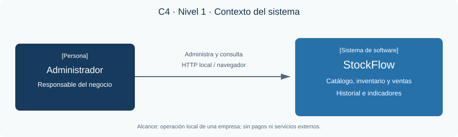
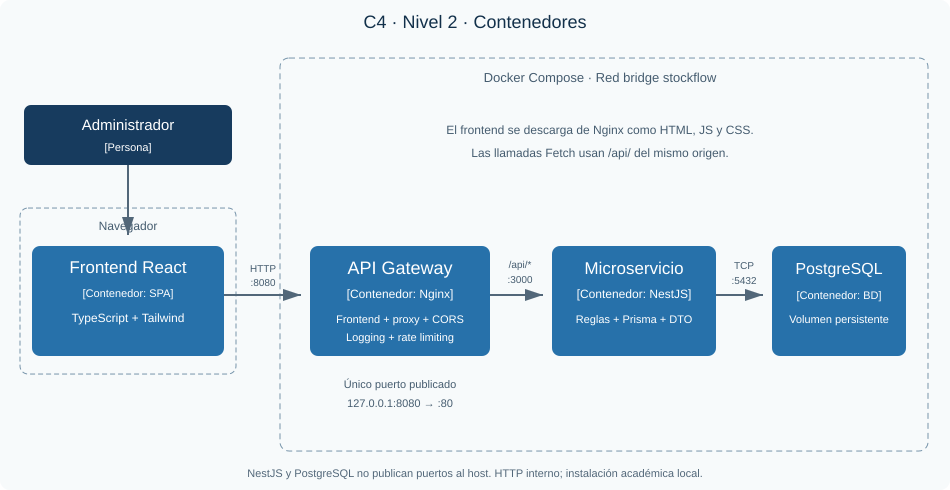

# Segundo Parcial — API Gateway y Microservicio Backend

## StockFlow

### Sistema Web de Gestión de Inventario y Ventas

**Universidad Católica Boliviana**

**Asignatura:** Tecnologías Web II

**Evaluación:** Segundo Parcial

**Docente:** Ing. Miguel A. Pacheco

**Estudiante:** Kevin Tapia Ali

**Tecnología asignada:** NestJS con TypeScript

**Fecha:** 20 de octubre de 2026

**Repositorio público:** pendiente de publicación por el estudiante.

Este informe describe la implementación de una aplicación local para controlar productos, inventario y ventas mediante una arquitectura con API Gateway, microservicio y base de datos persistente.

**Estado del documento:** preparado para revisión y exportación a PDF. Las evidencias de ejecución deben incorporarse después de las pruebas manuales. No se presentan capturas ni resultados fabricados.

<!-- PAGE -->

## 1. Introducción y problema de negocio

Las pequeñas empresas suelen administrar su inventario mediante cuadernos o archivos de cálculo separados del registro de ventas. Esto dificulta conocer las existencias disponibles, identificar necesidades de reposición y reconstruir el origen de una diferencia de stock. La duplicación de productos y las ventas sin disponibilidad afectan la confiabilidad de la información.

StockFlow propone centralizar estos procesos en una aplicación web. El sistema mantiene un catálogo categorizado, registra movimientos y relaciona cada venta con sus productos y descuentos de inventario. El alcance se limita a la gestión operativa local; no incluye cobros electrónicos, facturación tributaria ni integración bancaria.

## 2. Justificación y objetivos

El caso de negocio permite aplicar los contenidos del parcial a un problema concreto. El API Gateway concentra políticas de comunicación; el microservicio organiza las reglas del dominio; la base relacional protege relaciones e integridad.

**Objetivo general:** implementar un sistema web de inventario y ventas, con una API NestJS accesible mediante Nginx y persistencia PostgreSQL, preparado para ejecutarse con Docker Compose.

**Objetivos específicos:**

- Gestionar categorías y productos mediante operaciones CRUD.
- Conservar el historial de entradas, salidas y ventas.
- Evitar stock negativo y ventas parciales mediante transacciones.
- Aplicar CORS, logging y rate limiting en el Gateway.
- Documentar arquitectura, endpoints, despliegue y procedimiento de validación.

## 3. C4 Nivel 1: contexto



El administrador del negocio es el actor principal. Utiliza StockFlow desde un navegador para mantener el catálogo, registrar operaciones y consultar indicadores. El sistema no depende de servicios externos para sus funciones de negocio.

<!-- PAGE -->

## 4. Arquitectura del sistema

La solución separa presentación, entrada HTTP, reglas de negocio y persistencia. React y TypeScript implementan la interfaz; Vite compila sus archivos. Nginx sirve la aplicación compilada y dirige las rutas /api/ al backend. NestJS procesa solicitudes y accede a PostgreSQL mediante Prisma.

## 5. C4 Nivel 2: contenedores



El frontend es una aplicación que se ejecuta en el navegador, no un servidor público adicional. El Gateway publica 127.0.0.1:8080. El microservicio escucha internamente en 3000 y PostgreSQL en 5432. Una red bridge de Compose permite resolver los nombres backend y db.

**Recorrido de una petición:** React envía JSON al Gateway; Nginx aplica políticas y lo reenvía conservando la ruta; NestJS valida el DTO, ejecuta la lógica mediante el servicio y repository y devuelve el resultado. La respuesta regresa por el mismo Gateway.

**Límites:** la aplicación no implementa autenticación. Se configura para una demostración local. La exposición pública requeriría autenticación, autorización, HTTPS y revisión de seguridad.

<!-- PAGE -->

## 6. Implementación del API Gateway

Nginx es el único punto de entrada HTTP publicado. La ruta raíz sirve React, mientras /api/ se reenvía a NestJS conservando métodos, cuerpos JSON, parámetros y códigos de negocio. Swagger también se consulta por el Gateway en /api/docs.

| Característica | Implementación |
|---|---|
| CORS | Origen exacto configurable; OPTIONS 204; NestJS no duplica cabeceras |
| Logging | Accesos JSON a stdout; errores a stderr; requestId correlacionado |
| Rate limiting | 10 solicitudes/s por IP y ráfaga de 40; respuesta 429 con Retry-After |
| Proxy | Cabeceras Host, IP, protocolo y X-Request-ID; DNS interno Docker |
| Seguridad HTTP | nosniff, SAMEORIGIN y Referrer-Policy |
| Indisponibilidad | Errores upstream 502/503/504 normalizados a 503 JSON |

Los recursos Swagger se excluyen del límite para permitir el uso de la documentación. Las rutas internas de React se resuelven con fallback a index.html. El endpoint /gateway-health verifica Nginx; /api/health verifica también backend y BD.

## 7. Microservicio NestJS

El backend se organiza en categorías, productos, inventario, ventas y dashboard. Cada módulo expone controllers y delega las reglas a services. Los repositories concentran consultas y proporcionan acceso a transacciones. NestJS suministra estas dependencias mediante sus providers.

Los DTO utilizan class-validator y class-transformer. ValidationPipe transforma consultas permitidas, rechaza campos desconocidos y valida tipos y límites. TypeScript usa modo estricto. El filtro global convierte errores esperados en 400, 404 o 409 y evita enviar trazas internas. Swagger describe rutas y cuerpos.

**Ejemplo:** CreateSaleDto acepta cliente y productos con cantidades. No admite precios ni totales del cliente. SalesService obtiene precios desde PostgreSQL, calcula con Decimal, registra detalles y movimientos y descuenta stock en una transacción.

**Responsabilidad del frontend:** presentar y validar formularios, controlar carga y errores, consumir la API y mostrar confirmaciones. Los indicadores del dashboard provienen de consultas reales; no se mantienen tablas ficticias en la interfaz.

<!-- PAGE -->

## 8. Diseño de datos y persistencia

| Entidad | Datos y relaciones principales |
|---|---|
| Category | Nombre único normalizado, descripción; agrupa productos |
| Product | SKU único, precio, stock, mínimo, estado y categoría |
| InventoryMovement | Producto, tipo, cantidad, motivo, fecha y venta opcional |
| Sale | Cliente, total, estado y datos de anulación |
| SaleItem | Venta, producto, cantidad, precio y datos históricos del producto |

PostgreSQL usa UUID como claves primarias y claves foráneas con eliminación restringida. Se definen índices en relaciones, fechas y estado. Los CHECK SQL complementan la validación de la API e impiden valores negativos y estados de anulación contradictorios.

Los precios se almacenan como NUMERIC(12,2) y totales como NUMERIC(14,2). Prisma opera con Decimal y la API entrega cadenas con dos decimales. React usa centavos enteros para estimaciones; el backend calcula el resultado definitivo.

## 9. Integridad de inventario y ventas

Crear un producto con stock inicial genera un movimiento de apertura. Después, las existencias se modifican desde inventario, no mediante una edición silenciosa del producto. Las salidas usan descuentos condicionados a stock suficiente.

Registrar una venta agrupa lectura de precios, creación de detalles, descuento de existencias y movimientos en una transacción Serializable. Si falla cualquier producto, todo se revierte. Los conflictos de concurrencia se reintentan hasta tres veces; si persisten se informa 409.

La anulación exige que la venta continúe confirmada. Su cambio de estado, restitución y movimientos ocurren en la misma transacción. Un segundo intento recibe 409 y no restituye unidades nuevamente.

Las ventas y movimientos no se eliminan. Los productos con historial se desactivan; las categorías con productos no pueden borrarse. Esto conserva las referencias necesarias para explicar el inventario.

## 10. Migraciones y seed

El esquema y SQL inicial se versionan en backend/prisma. El arranque aplica migrate deploy y carga ejemplos si SEED_ON_START está habilitado. El seed agrega registros ausentes por categoría normalizada y SKU, sin restablecer datos existentes. No se utiliza reset ni sincronización destructiva.

<!-- PAGE -->

## 11. Contenerización y arranque

Docker Compose declara gateway, backend y db en una red bridge. PostgreSQL utiliza el volumen postgres_data. El Dockerfile Gateway compila React en una etapa Node y copia sus archivos a Nginx. El backend compila TypeScript y genera Prisma; ejecuta como usuario node y conserva una CLI para migraciones.

Las dependencias de salud ordenan el arranque: PostgreSQL debe aceptar conexiones, después NestJS debe responder a una consulta real de BD y finalmente inicia Nginx. Los healthchecks informan el estado; no garantizan por sí solos recuperación de cualquier fallo posterior.

Comando principal desde la raíz, después de copiar .env.example a .env:

```powershell
docker compose up --build -d
docker compose ps
docker compose logs --tail=40 backend
```

Frontend: http://localhost:8080. Swagger: http://localhost:8080/api/docs. Backend y BD no publican puertos al host. Detener con docker compose down conserva el volumen; añadir --volumes elimina los datos.

## 12. Documentación breve de endpoints

| Recurso | Operaciones |
|---|---|
| /api/categories | GET y POST; /:id admite GET, PATCH y DELETE |
| /api/products | GET con búsqueda/filtros/paginación y POST; /:id GET, PATCH y DELETE |
| /api/inventory/movements | GET paginado por producto y POST de entrada/salida |
| /api/sales | GET y POST; /:id GET; /:id/cancel PATCH |
| /api/dashboard/summary | GET de indicadores reales |
| /api/health | GET de salud backend y consulta a PostgreSQL |

Una creación devuelve 201; las consultas y actualizaciones 200; la eliminación permitida 204 sin cuerpo. Validaciones devuelven 400, inexistencia 404, conflictos 409, límite 429 e indisponibilidad 503. El contrato completo y ejemplos están en docs/api/ENDPOINTS.md y Swagger.

## 13. Control de versiones

Se prepara Git Flow con main para la entrega, develop para integración y feature/* o release/* para cambios reales. El README documenta publicación manual en un repositorio público. Se excluyen .env, dependencias y archivos temporales. No se publica ni configura un remoto automáticamente.

<!-- PAGE -->

## 14. Evidencias y validación

La generación del proyecto no ejecutó Docker Compose, servidores, navegador ni pruebas de integración. El registro de comprobaciones estáticas está en docs/VERIFICACION.md. Los siguientes espacios deben sustituirse por evidencias reales antes de la entrega final.

> EVIDENCIA A — Insertar captura compacta de docker compose ps con gateway, backend y db saludables. Fecha, entorno y commit: pendientes.

> EVIDENCIA B — Insertar captura de Swagger/Postman con CRUD exitoso y encabezado X-Request-ID. Resultado observado: pendiente.

> EVIDENCIA C — Insertar captura de stock antes/después de venta y anulación. Demostrar segundo intento 409 y rollback por producto insuficiente. Resultado observado: pendiente.

> EVIDENCIA D — Insertar evidencia compacta de persistencia tras down/up y respuesta 429. Resultado observado: pendiente.

La guía docs/evidencias/README.md detalla escenarios adicionales, incluidos CORS, validación, errores de negocio, rutas SPA y concurrencia. El script manual-demo.ps1 crea datos y comprueba una secuencia controlada; rate-limit.mjs permite observar la distribución de respuestas ante una ráfaga.

## 15. Resultados y conclusiones

Se preparó una implementación que separa la interfaz, el acceso HTTP, las reglas de negocio y la persistencia. El Gateway concentra tres funciones transversales. El microservicio aplica patrones DTO, Repository e inyección de dependencias. El diseño de transacciones y restricciones busca proteger el inventario y conservar trazabilidad.

Estos resultados corresponden a archivos implementados y documentados; no equivalen a una validación de ejecución. La construcción de imágenes, las pruebas manuales y las evidencias son necesarias para confirmar el comportamiento en el entorno de entrega.

La solución mantiene el alcance académico: un solo microservicio y despliegue local sin autenticación. Antes de una exposición pública se deben incorporar controles de acceso y HTTPS. La publicación del repositorio y el PDF final con evidencias completarán la entrega.

## 16. Referencias

- NestJS, documentación OpenAPI: https://docs.nestjs.com/openapi/introduction
- Nginx, módulo proxy HTTP: https://nginx.org/en/docs/http/ngx_http_proxy_module.html
- Prisma, versión utilizada 6.16.2: https://github.com/prisma/prisma/tree/6.16.2
- Docker Compose, orden de arranque: https://docs.docker.com/compose/how-tos/startup-order/
